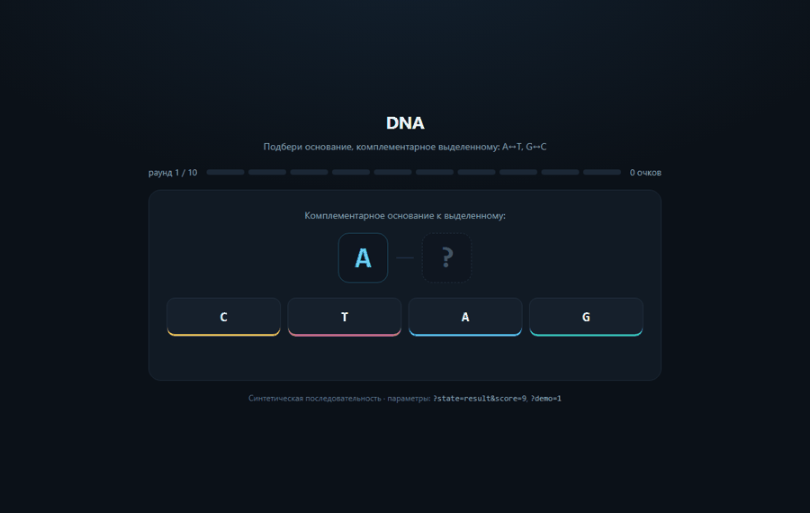

# Портфолио биоинформатика

Семь небольших проектов, собранных под вакансию отдела биоинформатики и системного анализа:
пайплайны, их поддержка, тестирование, воспроизводимость, экономия ресурсов и документация.

Все данные **синтетические** или публичные (GIAB, 1000 Genomes). Никаких реальных пациентов.
Все отчёты генерируются скриптами, картинки не рисуются руками.

## Живой сайт

Всё, что генерируется, открывается в браузере без установки и сборки:

| Что | Адрес |
|---|---|
| Главная страница со всеми отчётами | **https://kepanasyuke.github.io/bioinformatics/** |
| Игра «DNA» | **https://kepanasyuke.github.io/bioinformatics/web/dna-game/** |
| Отчёты по проектам | ссылки в колонке «Отчёт» ниже ведут сразу на живые страницы |

Сайт собирается из этого же репозитория через GitHub Pages: ветка `master`, корень,
`.nojekyll` отключает Jekyll, чтобы HTML отдавался как есть. Отдельной сборки нет —
что запушили, то и открывается.

Интерактивные Streamlit-дашборды (`web/dashboards/`) на Pages не живут: им нужен
Python-сервер. Они запускаются локально одной командой и описаны в `requirements-optional.txt`.

| № | Проект | Что показывает | Отчёт |
|---|---|---|---|
| 01 | [WGS-пайплайн](projects/01_wgs_pipeline) | CWL + Docker, воспроизводимость, версии инструментов | [открыть](https://kepanasyuke.github.io/bioinformatics/projects/01_wgs_pipeline/docs/report.html) |
| 02 | [Регрессионные тесты](projects/02_regression) | сравнение с эталоном, порог F1, падение CI при регрессии | [открыть](https://kepanasyuke.github.io/bioinformatics/projects/02_regression/docs/report.html) |
| 03 | [Тулчейн установки](projects/03_toolchain) | сборка из исходников, sha256, идемпотентность | [открыть](https://kepanasyuke.github.io/bioinformatics/projects/03_toolchain/docs/report.html) |
| 04 | [Бюджет кластера](projects/04_cluster_budget) | sacct, лимиты памяти и CPU, экономия core-hours | [открыть](https://kepanasyuke.github.io/bioinformatics/projects/04_cluster_budget/docs/report.html) |
| 05 | [RNA-Seq QC](projects/05_rnaseq) | fastp → STAR → counts, PCA, volcano | [открыть](https://kepanasyuke.github.io/bioinformatics/projects/05_rnaseq/docs/report.html) |
| 06 | [Починка legacy](projects/06_legacy) | 10 багов в чужом bash, PR + тест на каждый | [открыть](https://kepanasyuke.github.io/bioinformatics/projects/06_legacy/docs/report.html) |
| 07 | [База частот](projects/07_freqdb) | SQLite, аннотация VCF, фильтры по популяциям | [открыть](https://kepanasyuke.github.io/bioinformatics/projects/07_freqdb/docs/report.html) |

## Правила кода

Коротко: **один выход из функции, никаких `continue`, вложенность не глубже трёх,
функции по одной-две строки, описание каждой функции простыми словами в README**.
Подробно с примерами — [STYLE.md](STYLE.md). Проверяется линтером `tools/check_style.py`,
который висит в CI и в `make lint`.

## Быстрый старт

```bash
make lint      # правила стиля
make test      # тесты всех проектов
make reports   # пересобрать все HTML-отчёты
make headers   # пересобрать анимированные шапки
make all       # всё вместе
```

Без make:

```bash
python tools/check_style.py .
python tools/run_tests.py
python projects/01_wgs_pipeline/src/wgs_pipeline.py
python -m tools.viz.header
```

## Зависимости

Ядро — только стандартная библиотека Python 3.10+. Внешние пакеты не нужны,
поэтому всё собирается в чистом контейнере и на кластере без интернета.

Опционально: `cairosvg` для GIF-шапок, `streamlit` для интерактивных дашбордов
(см. `requirements-optional.txt`).

## Что смотреть в первую очередь

**[Играть: DNA — подбери комплементарное основание](https://kepanasyuke.github.io/bioinformatics/web/dna-game/)**

Игра открывается прямо в браузере: A↔T, G↔C, десять раундов, счёт и GC-состав цепи.
Тот же файл лежит в репозитории — `web/dna-game/index.html`, без сборки и зависимостей.



Все семь отчётов собраны на одной странице: **[kepanasyuke.github.io/bioinformatics](https://kepanasyuke.github.io/bioinformatics/)**

