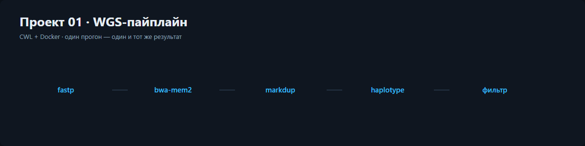

# Проект 01. WGS-пайплайн на CWL

Пять шагов от сырых fastq до отфильтрованного VCF. Версии инструментов зафиксированы
в образах контейнеров, поэтому повторный прогон через год даёт тот же результат.
Тяжёлые инструменты в демо не запускаются: по умолчанию работает `--dry-run`, который
печатает реальные команды.

```bash
python projects/01_wgs_pipeline/src/wgs_pipeline.py          # dry-run + отчёт
python projects/01_wgs_pipeline/src/wgs_pipeline.py --run    # пометить как реальный прогон
```

Отчёт: [онлайн на GitHub Pages](https://kepanasyuke.github.io/bioinformatics/projects/01_wgs_pipeline/docs/report.html) · [файл в репозитории](docs/report.html). Схема пайплайна: [pipeline/germline.cwl](pipeline/germline.cwl).

## Шаги

| Шаг | Инструмент | Версия | Минуты |
|---|---|---|---|
| тримминг | fastp | 0.23.4 | 21 |
| выравнивание | bwa-mem2 | 2.2.1 | 184 |
| дубликаты | gatk MarkDuplicates | 4.6.0.0 | 46 |
| вызов вариантов | gatk HaplotypeCaller | 4.6.0.0 | 212 |
| фильтрация | bcftools | 1.20 | 9 |

## Функции

### `load_config(path)`
Простыми словами: читает json с путями, потоками и образами контейнеров.
Вход: путь к файлу. Выход: словарь настроек.

### `check_reference(paths)`
Простыми словами: проверяет, каких файлов референса не хватает на диске.
Вход: список путей. Выход: список отсутствующих путей.

### `step_command(step, sample)`
Простыми словами: подставляет имя образца в шаблон команды шага.
Вход: описание шага и имя образца. Выход: строка команды.

### `build_job_order(sample, config)`
Простыми словами: собирает заказ для cwl из настроек и имени образца.
Вход: имя образца и настройки. Выход: словарь заказа.

### `run_step(step, sample, dry_run)`
Простыми словами: готовит один шаг к запуску и возвращает его карточку.
Вход: описание шага, имя образца, флаг dry-run. Выход: словарь с командой и кодом.

### `run_pipeline(sample, dry_run)`
Простыми словами: проходит по всем шагам по порядку.
Вход: имя образца и флаг dry-run. Выход: список карточек шагов.

### `collect_outputs(results)`
Простыми словами: перечисляет, что получилось после прогона.
Вход: карточки шагов. Выход: список названий результатов.

### `coverage_bins(seed, count, base)`
Простыми словами: делает синтетическую глубину покрытия по бинам генома.
Вход: seed, число бинов, средняя глубина. Выход: список чисел.

### `demo_variants(seed, count)`
Простыми словами: расставляет синтетические варианты по хромосоме.
Вход: seed и число вариантов. Выход: список вариантов с позицией 0..1.

### `mean_depth(values)`
Простыми словами: считает среднюю глубину.
Вход: список чисел. Выход: округлённое среднее.

### `step_rows(results)`
Простыми словами: делает строки таблицы шагов.
Вход: карточки шагов. Выход: список строк для отчёта.

### `variant_track(variants, width, height)`
Простыми словами: рисует дорожку с вариантами на хромосоме.
Вход: варианты и размеры. Выход: строка SVG.

### `sections(...)`
Простыми словами: собирает все блоки отчёта по порядку.
Вход: покрытие, варианты, карточки шагов. Выход: список HTML-секций.

### `write_report(path, ...)`
Простыми словами: склеивает страницу отчёта и сохраняет её на диск.
Вход: путь и данные. Выход: путь к сохранённому файлу.

### `main(argv)`
Простыми словами: точка входа, делает всё вместе и печатает итог.
Вход: аргументы командной строки. Выход: код возврата.

## Что честно, а что нет

Данные синтетические: глубина, варианты и время шагов сгенерированы с фиксированным seed.
Реальные команды и версии инструментов — настоящие, их можно запустить на кластере,
подставив свой референс и свой образец.
