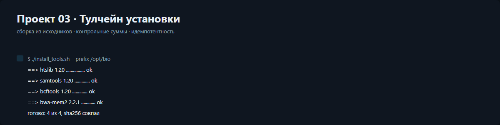

# Проект 03. Тулчейн установки и компиляции

Половина боли в биоинформатике — «на этой машине не собирается». Здесь установка
описана манифестом: имя, версия, тип (исходники или jar), sha256, зависимости.
Скрипт проверяет сумму, ставит в порядке зависимостей, пишет лог и умеет `--dry-run`.

```bash
bash projects/03_toolchain/src/install_tools.sh          # dry-run
DRY_RUN=0 PREFIX=/opt/bio bash projects/03_toolchain/src/install_tools.sh
python projects/03_toolchain/src/toolchain.py            # отчёт
```

Отчёт: [docs/report.html](docs/report.html). Манифест: [data/manifest.tsv](data/manifest.tsv).

## Манифест

```
name        version  kind       sha256  deps
htslib      1.20     autotools  ...     -
samtools    1.20     autotools  ...     htslib
bcftools    1.20     autotools  ...     htslib
bwa-mem2    2.2.1    autotools  ...     -
picard      3.3.0    jar        ...     samtools
gatk        4.6.0.0  jar        ...     picard
```

Порядок сборки не задаётся руками: он вычисляется по полю `deps`. Если в манифесте
случайно получился цикл, функция порядка просто возвращает пустой список — установщик
не зависнет.

## Функции Python

### `read_manifest(path)`
Простыми словами: читает таблицу инструментов и раскладывает её по полям.
Вход: путь к tsv. Выход: список словарей с полями name, version, kind, sha256, deps.

### `check_sum(path, expected)`
Простыми словами: сверяет sha256 файла с ожидаемым.
Вход: путь и ожидаемая сумма. Выход: True или False.

### `plan_actions(spec, prefix)`
Простыми словами: показывает, какие команды выполнит установка.
Вход: описание инструмента и префикс. Выход: список команд.

### `dependency_order(specs)`
Простыми словами: расставляет инструменты так, чтобы зависимости шли первыми.
Вход: список инструментов. Выход: список имён в порядке сборки.

### `matrix_rows(specs, order)`
Простыми словами: делает строки таблицы «инструмент × версия × зависимости».
Вход: инструменты и порядок. Выход: список строк.

### `spec_flags(specs, prefix)`
Простыми словами: помечает строки таблицы зелёным или красным.
Вход: инструменты и префикс. Выход: список меток для таблицы.

### `step_rows(specs, order)`
Простыми словами: собирает шаги установки для вывода в терминал.
Вход: инструменты и порядок. Выход: список пар «шаг — команда».

### `dependency_graph(order, specs)`
Простыми словами: рисует цепочку сборки картинкой.
Вход: порядок и инструменты. Выход: строка SVG.

### `sections(specs, order, prefix)` / `write_report(path, ...)`
Простыми словами: собирают и сохраняют отчёт.
Вход: данные тулчейна. Выход: список секций или путь к файлу.

### `main(argv)`
Простыми словами: точка входа.
Вход: аргументы. Выход: код возврата.

## Функции bash

### `require_var(value, name)`
Простыми словами: падает, если обязательная переменная пустая.
Выход: 0 или 1.

### `have_tool(name)`
Простыми словами: проверяет, есть ли программа в PATH.

### `fetch_source(url, dest)`
Простыми словами: скачивает архив или берёт его из кэша.

### `check_sum(file, expected)`
Простыми словами: сверяет контрольную сумму через sha256sum.

### `build_tool(name, version)`
Простыми словами: собирает инструмент из исходников или печатает план в dry-run.

### `install_jar(name, version)`
Простыми словами: кладёт jar и делает обёртку в bin.

### `write_log(name, status)`
Простыми словами: дописывает строку в лог установки.

### `main()`
Простыми словами: прогоняет шаги, останавливается на первой ошибке и возвращает её код.
Единственный выход — `break` из `while :`.

## Проверка стиля

```bash
python tools/check_style.py .
shellcheck projects/03_toolchain/src/install_tools.sh
```
