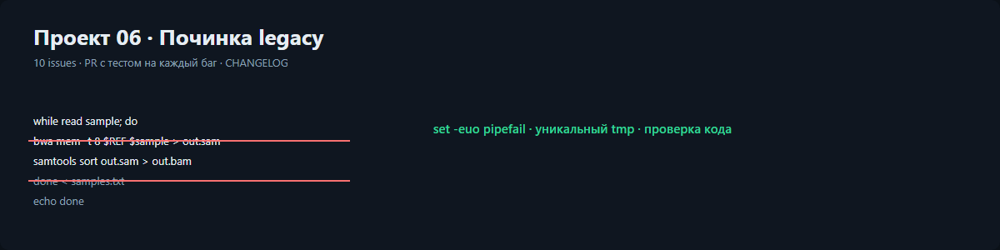

# Проект 06. Починка чужого пайплайна

В вакансии это отдельный пункт: «дебаг и исправление ошибок в чужом коде». Здесь
настоящая работа с настоящим legacy: сломанная версия сохранена как артефакт, каждый
из десяти багов оформлен issue, закрыт исправлением и проверяется тестом или `shellcheck`.

```bash
python projects/06_legacy/src/legacy.py
bash -n projects/06_legacy/src/fixed_pipeline.sh
```

Отчёт: [docs/report.html](docs/report.html). Список багов: [ISSUES.md](ISSUES.md).
История изменений: [CHANGELOG.md](CHANGELOG.md).

## Файлы

| Файл | Что это |
|---|---|
| `legacy/broken_pipeline.sh.orig` | версия до исправления, хранится как артефакт (расширение `.orig`, чтобы линтер её не трогал) |
| `src/fixed_pipeline.sh` | переписанная версия: один выход, без `continue`, вложенность ≤ 3 |
| `ISSUES.md` | таблица B1…B10: что не так и как исправлено |
| `CHANGELOG.md` | что изменилось и какие метрики получились |

## Десять багов

Коротко: отсутствие `set -euo pipefail`, `for f in $(ls ...)`, `cd` без кавычек,
`continue` в глубине, три `return` в одной функции, вложенность пять, `rm -rf` без
кавычек, общий `/tmp` на все образцы, непроверенные коды возврата, `grep` вместо
разбора VCF. Подробности и последствия — в [ISSUES.md](ISSUES.md).

## Функции Python

### `parse_vcf_line(line)`
Простыми словами: разбирает строку VCF по полям, а не регуляркой.
Вход: строка файла. Выход: словарь с chrom, pos, ref, alt, filter или пустой словарь.

### `count_variants(path)`
Простыми словами: считает варианты в файле, пропуская заголовки.
Вход: путь. Выход: целое число.

### `write_demo(data_dir)`
Простыми словами: создаёт демонстрационный VCF и два файла прогонов.
Вход: папка. Выход: путь к папке.

### `read_runs(path)`
Простыми словами: читает таблицу прогонов.
Вход: путь к tsv. Выход: список записей run_id, minutes, failed.

### `average(values)`
Простыми словами: среднее по списку.
Вход: числа. Выход: округлённое среднее.

### `compare_runs(before, after)`
Простыми словами: сравнивает прогоны до и после починки.
Вход: два списка прогонов. Выход: словарь с временем, ускорением и числом падений.

### `issue_board()`
Простыми словами: рисует канбан-доску с багами.
Вход: нет. Выход: HTML-блок.

### `summary_cards(metrics)`
Простыми словами: собирает четыре верхние плитки.
Вход: метрики сравнения. Выход: HTML.

### `sections(metrics)` / `write_report(path, metrics)`
Простыми словами: собирают и сохраняют отчёт.
Вход: метрики. Выход: список секций или путь к файлу.

### `main(argv)`
Простыми словами: точка входа.
Вход: аргументы. Выход: код возврата.

## Функции bash (в `fixed_pipeline.sh`)

### `require_var(value, name)`
Простыми словами: останавливает скрипт, если обязательная переменная пустая.

### `safe_rm_dir(target)`
Простыми словами: удаляет каталог, но отказывается удалять пустое и `/`.

### `tmp_dir_for(sample)`
Простыми словами: делает отдельный рабочий каталог на образец.

### `list_samples(folder)`
Простыми словами: перечисляет fastq без пробелов в именах.

### `check_exit(code, step)`
Простыми словами: превращает код возврата в понятное сообщение.

### `align_sample(sample, folder)`
Простыми словами: запускает bwa и samtools, проверяя оба кода возврата.

### `process_sample(sample)`
Простыми словами: обработка одного образца с пропуском уже сделанных.

### `main()`
Простыми словами: прогоняет всё, останавливается на первой ошибке, единственный выход — `break`.

## Что видно на скриншоте

Канбан: колонка «Закрыто» с семью карточками, у каждой подпись «PR + тест».
Терминал «Было»: пять уровней вложенности с `continue` в середине.
