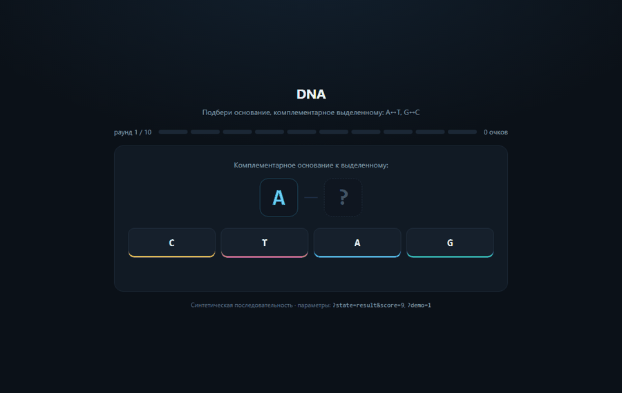
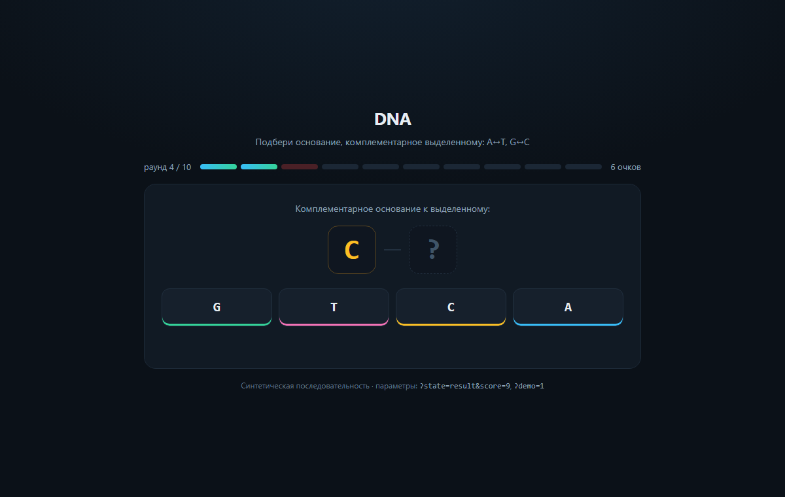
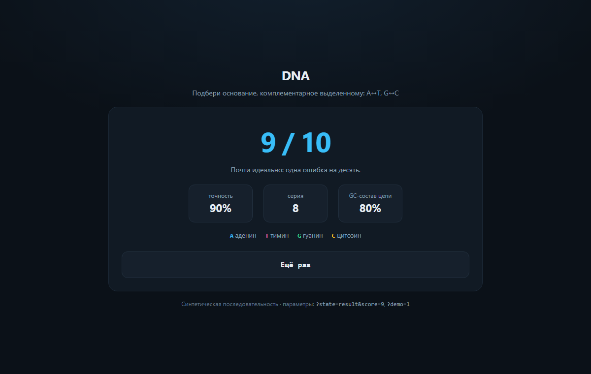

# DNA · подбери комплементарное основание

Простая игра на одну биологическую идею: **A соединяется с T, G с C**. Десять раундов,
четыре кнопки, счёт и разбор ошибки после каждого ответа. В конце — точность,
лучшая серия и GC-состав пройденной цепи.

Открыть локально: `web/dna-game/index.html` (один файл, без сборки и зависимостей).

## Скриншоты

| Раунд | Итог |
|---|---|
|  |  |

## Как это устроено

| Элемент | Что делает |
|---|---|
| `targets` | десять случайных оснований, но с фиксированным seed из адреса |
| `PAIRS` | правило комплементарности: A↔T, G↔C |
| `results` | массив из true/false — из него рисуется полоса прогресса |
| `gcShare` | считает долю G и C в цепи и показывает в итоге |

Фиксированный seed важен не для красоты: благодаря ему скриншоты
и GIF воспроизводятся один в один при повторном запуске.

## Параметры в адресе

| Адрес | Что показывает |
|---|---|
| `index.html` | обычная игра с начала |
| `?state=play&seed=7&score=6` | середина партии на 4-м раунде |
| `?state=result&score=9` | экран результата 9 из 10 |
| `?demo=1` | автопрохождение, из него собирается GIF |

## Как пересобрать картинки

```bash
python tools/shoot_game.py
```

Скрипт запускает headless Chrome (или Edge), снимает два статических экрана
и шесть кадров автопрохождения, затем склеивает GIF через Pillow.
Результат кладётся в `docs/`: `game-play.png`, `game-result.png`, `game-demo.gif`.

## Почему именно эта игра

Она проверяет не знание bash, а базовое понимание молекулярной биологии — одного
из пунктов «будет плюсом» в вакансии. Проходится за минуту, не требует объяснений
и сразу показывает, что человек помнит: аденин спаривается с тимином.
